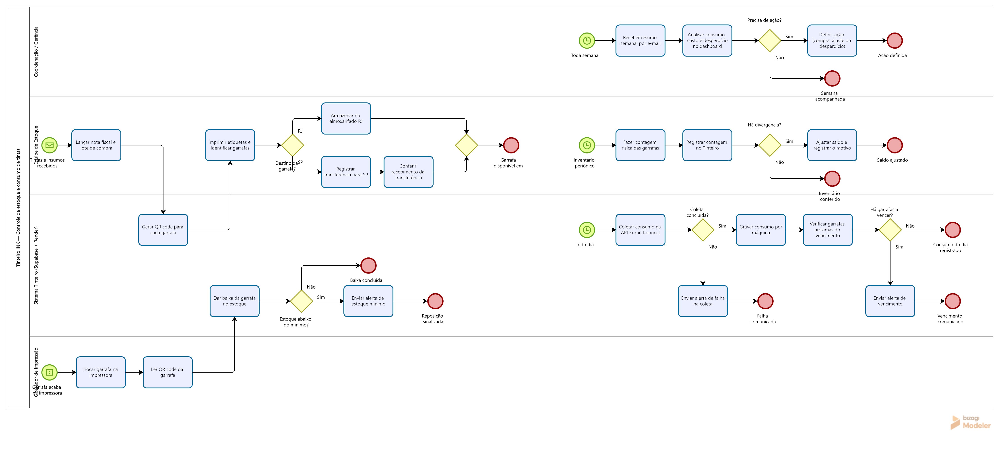

# Tinteiro INK: controle de tintas de impressão em duas fábricas

Aplicação que criei para controlar o **estoque e o consumo de tintas de impressão DTG** em duas fábricas de produção sob demanda (RJ e SP). Ela substituiu planilhas manuais por um sistema com rastreio por garrafa, coleta automática de consumo e alertas.

🏆 **Projeto vencedor do desafio interno de IA da área.** Foi aprovado pela gerência e está em uso desde setembro de 2026.

📄 **[Baixar o diagrama em PDF](Tinteiro-INK.pdf)**

---

## 🔴 O problema

- O estoque de tinta era controlado em **três planilhas separadas**, atualizadas à mão.
- Não havia como saber **quanto cada máquina consumia de fato**, nem o custo e o desperdício por período.
- As transferências entre as fábricas e as **datas de vencimento** das garrafas não tinham rastreio.
- O preenchimento dependia de pessoas: se alguém esquecia, o histórico ficava com buracos.

## 🟢 A solução

| Frente | O que foi feito |
|---|---|
| **Rastreabilidade** | Cada garrafa recebe uma **etiqueta com QR code** (impressora térmica, ZPL), ligada ao lote de compra e à nota fiscal |
| **Baixa no consumo** | Na troca de garrafa, o operador lê o QR code na máquina e o sistema dá a baixa na hora |
| **Coleta automática** | Uma **função agendada** lê todo dia o consumo na **API do fabricante das impressoras** e grava por máquina, sem depender de ninguém |
| **Alertas por e-mail** | Falha na coleta, estoque abaixo do mínimo, garrafas a vencer e resumo semanal |
| **Dashboard** | Consumo, custo e desperdício por máquina, fábrica e período, dentro da própria ferramenta |
| **Acesso controlado** | Login com perfis: gerência, coordenação, equipe de estoque e operação. O cadastro de usuários é feito no próprio app |

## 📈 Resultado (de ago a nov/2026)

| Indicador | Número |
|---|---|
| Planilhas manuais substituídas | **3 → 1 sistema** com histórico em banco |
| Garrafas rastreadas individualmente por QR code | **451** |
| Movimentações registradas (entrada, abertura, baixa, descarte) | **772** |
| Coletas automáticas na API das impressoras | **209, sem nenhuma falha** (95% completas, 5% parciais) |
| Peças com consumo de tinta monitorado | **mais de 760 mil**, em 7 impressoras e 170 dias de série |
| Alertas automáticos enviados por e-mail | **269**, em 11 tipos |
| Aberturas de garrafa fora da ordem de validade detectadas | **41** |
| Pessoas usando o sistema | **16**, em 5 perfis de acesso |

Na prática, a gestão passou a ver **consumo, custo e desperdício por máquina**, e as falhas de processo (garrafa aberta fora da ordem de validade, troca sem baixa) agora geram alerta automático em vez de aparecer só no inventário.

## 🧭 O fluxo do processo (BPMN 2.0)

Modelei o processo no **Bizagi Modeler** antes e durante o desenvolvimento, para alinhar as responsabilidades de cada área.

| Subprocesso | Gatilho | O que acontece |
|---|---|---|
| **Entrada de tintas e insumos** | Mensagem: material recebido | Lançamento da nota fiscal e do lote, geração de QR code por garrafa, etiquetagem e destino (almoxarifado RJ ou transferência para SP com conferência no recebimento) |
| **Consumo na impressora** | Condição: garrafa vazia | O operador troca a garrafa, lê o QR code e o sistema dá baixa; se o saldo fica abaixo do mínimo, sai um alerta de reposição |
| **Coleta diária de consumo** | Timer: todo dia | A função agendada coleta o consumo na API do fabricante, grava por máquina e verifica garrafas a vencer; falhas e vencimentos geram alerta |
| **Acompanhamento semanal** | Timer: toda semana | A coordenação recebe o resumo por e-mail, analisa consumo, custo e desperdício no dashboard e define ações |
| **Inventário físico** | Timer: periódico | Contagem das garrafas, registro no sistema e ajuste de saldo com motivo quando há divergência |

**Raias:** Coordenação/Gerência · Equipe de Estoque · Sistema Tinteiro · Operador de Impressão

## 🧰 Stack

| Camada | Tecnologia |
|---|---|
| Banco de dados | **Supabase** (PostgreSQL) |
| Rotinas agendadas | Supabase Edge Functions + agendamento |
| App web | Hospedado no **Render** |
| Integração | API REST do fabricante das impressoras (autenticação por certificado) |
| Etiquetas | ZPL para impressora térmica, com QR code |
| Alertas | E-mail via SMTP |
| Modelagem de processo | Bizagi Modeler · BPMN 2.0 |

## 📁 Arquivos deste repositório

| Arquivo | Para quê |
|---|---|
| `Tinteiro-INK.bpm` | Modelo nativo do **Bizagi Modeler** |
| `tinteiro-ink.bpmn` | BPMN 2.0 padrão: abre no Bizagi, no Camunda Modeler ou no [bpmn.io](https://demo.bpmn.io) |
| `Tinteiro-INK.pdf` | Diagrama em PDF (A4 paisagem) |
| `Tinteiro-INK.png` | Imagem do diagrama |
| `gerar_bpmn.py` | Script Python que gera o `.bpmn` com o layout do diagrama |

## 🔒 Sobre o código

O código da aplicação é **privado**, porque roda com dados reais da empresa. Este repositório mostra o processo, a arquitetura e as decisões do projeto. Os papéis estão descritos por função, e nomes de pessoas, endereços internos e dados operacionais foram omitidos.

---

Feito por **Maísa Gomes Dias** · [LinkedIn](https://linkedin.com/in/maisagdias) · [GitHub](https://github.com/MaisaGD)
