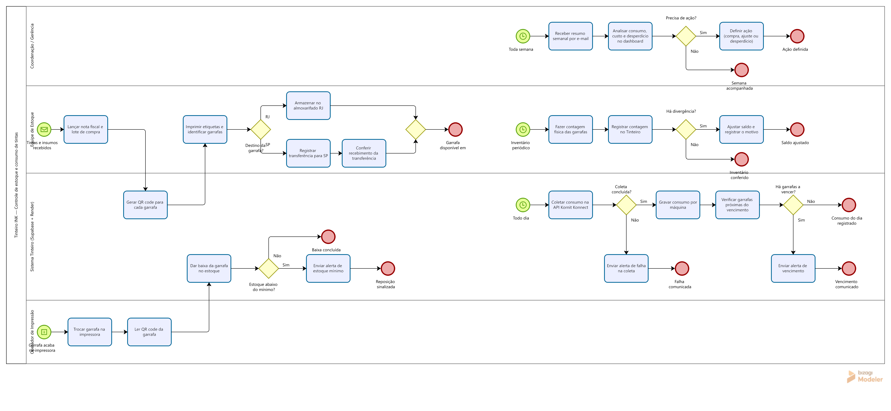

# Tinteiro INK — Fluxo de processo (BPMN)

Modelagem em BPMN 2.0 do **Tinteiro INK**, aplicação que criei para controlar o estoque e o consumo de tintas de impressão DTG em duas fábricas (RJ e SP), substituindo planilhas manuais por um sistema com rastreabilidade por garrafa, coleta automática de consumo e alertas.

📄 **[Baixar o diagrama em PDF](Tinteiro-INK.pdf)**

## O que o fluxo cobre

| Subprocesso | Gatilho | O que acontece |
|---|---|---|
| **Entrada de tintas e insumos** | Mensagem: material recebido | Lançamento da nota fiscal e do lote, geração de QR code por garrafa, etiquetagem e destino (almoxarifado RJ ou transferência para SP com conferência no recebimento) |
| **Consumo na impressora** | Condição: garrafa vazia | O operador troca a garrafa, lê o QR code e o sistema dá baixa; se o saldo fica abaixo do mínimo, sai um alerta de reposição |
| **Coleta diária de consumo** | Timer: todo dia | Uma função agendada coleta o consumo na API do fabricante das impressoras, grava por máquina e verifica garrafas a vencer; falhas de coleta e vencimentos geram alerta por e-mail |
| **Acompanhamento semanal** | Timer: toda semana | A coordenação recebe o resumo por e-mail, analisa consumo, custo e desperdício no dashboard e define ações |
| **Inventário físico** | Timer: periódico | Contagem das garrafas, registro no sistema e ajuste de saldo com motivo quando há divergência |

## Raias

- **Coordenação / Gerência** — acompanhamento e decisão
- **Equipe de Estoque** — entrada de notas, etiquetagem, transferências e inventário
- **Sistema Tinteiro** — Supabase (PostgreSQL + funções agendadas) e app web no Render
- **Operador de Impressão** — troca de garrafa e leitura do QR code

## Arquivos

| Arquivo | Para quê |
|---|---|
| `Tinteiro-INK.bpm` | Modelo nativo do **Bizagi Modeler** (abrir e editar no Bizagi) |
| `tinteiro-ink.bpmn` | BPMN 2.0 padrão — abre no Bizagi (*Exportar/importar → Importar BPMN*), Camunda Modeler ou [bpmn.io](https://demo.bpmn.io) |
| `Tinteiro-INK.pdf` | Diagrama em PDF (A4 paisagem, vetorial) gerado pelo Bizagi — para enviar ou imprimir |
| `Tinteiro-INK.png` | Imagem do diagrama exportada do Bizagi |
| `gerar_bpmn.py` | Script Python que gera o `.bpmn` com o layout do diagrama (`python gerar_bpmn.py`) |

## Stack do projeto

Supabase (PostgreSQL, Edge Functions agendadas) · Render · API do fabricante das impressoras · etiquetas ZPL com QR code · alertas por e-mail · dashboard de consumo

---

Modelado por **Maísa Gomes Dias** · [LinkedIn](https://linkedin.com/in/maisagdias)

> Os papéis estão descritos por função; nomes de pessoas, endereços internos e dados operacionais foram omitidos.
